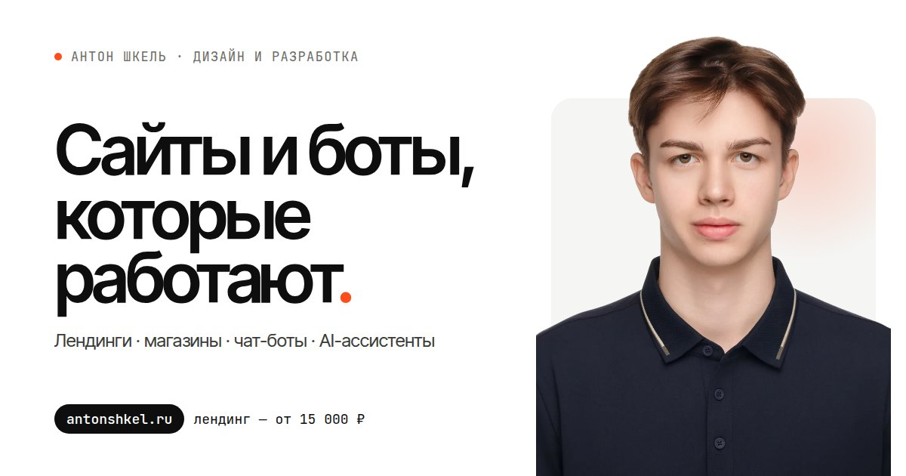
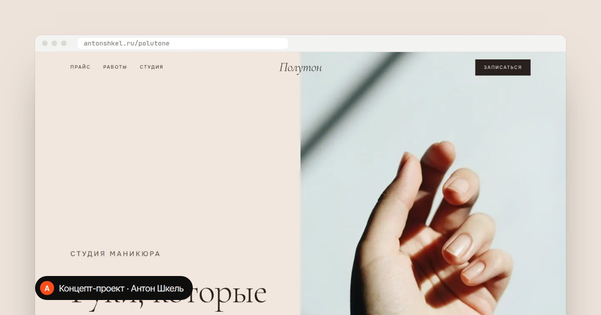
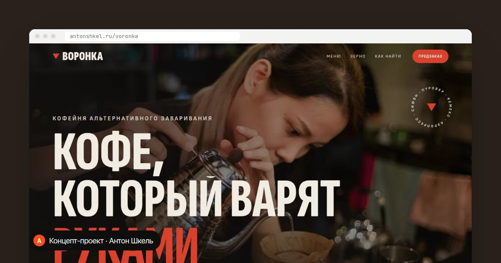
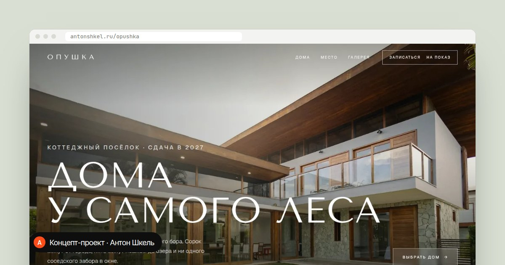
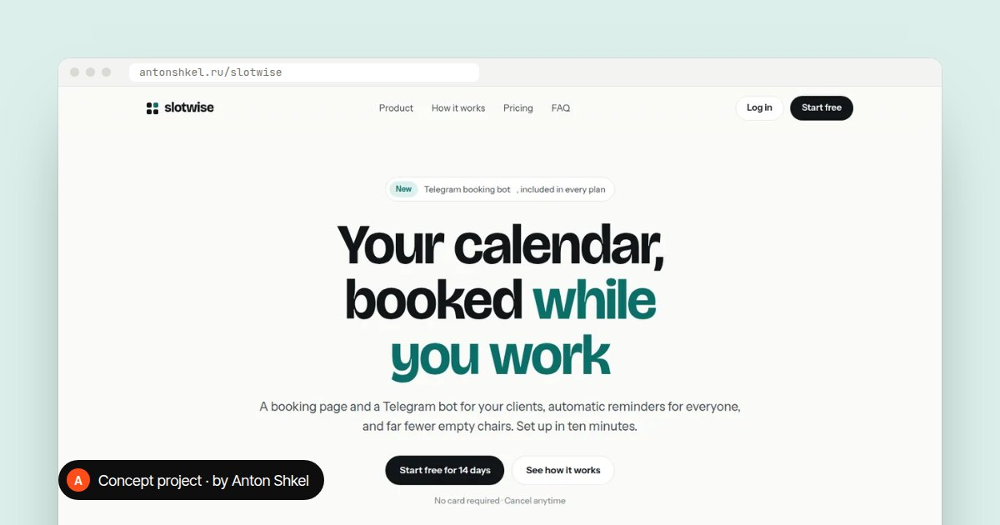

<div align="center">

<a href="https://antonshkel.ru"></a>

# antonshkel.ru

Сайт-портфолио Антона Шкеля: сайты, чат-боты и AI-ассистенты под ключ

[Открыть сайт](https://antonshkel.ru) · [English version](https://antonshkel.ru/?lang=en) · [Как развернуть](docs/DEPLOY.md)


</div>

## О проекте

Личный сайт-визитка с услугами, ценами и формой заявки, а также четыре концепт-сайта. Каждый концепт сделан отдельным работающим сайтом в своём стиле.

- Без фреймворков, сборщиков и npm: обычные HTML, CSS и JavaScript. Каждая страница лежит в одном файле.
- Два языка, RU и EN, переключаются без перезагрузки. Прямая ссылка на английскую версию: `?lang=en`.
- Все анимации написаны вручную: заставка, буквы заголовка, горизонтальная лента работ, стопка карточек услуг, бегущая строка от скорости прокрутки.
- Работает с клавиатуры и учитывает настройку «уменьшить движение» (`prefers-reduced-motion`).
- Своя форма заявок на PHP, без сторонних сервисов.
- Установка на чистый VPS одной командой: nginx, PHP-FPM и SSL скрипт настраивает сам.

## Работы

> Все четыре работы сделаны как концепты для вымышленных брендов. Адреса и телефоны на этих сайтах выдуманы.

| | |
|---|---|
| <a href="https://antonshkel.ru/polutone/"></a><br>Полутон: студия маникюра, лендинг и онлайн-запись | <a href="https://antonshkel.ru/voronka/"></a><br>Воронка: спешелти-кофейня, меню и предзаказ |
| <a href="https://antonshkel.ru/opushka/"></a><br>Опушка: коттеджный посёлок, планировки и запись на показ | <a href="https://antonshkel.ru/slotwise/"></a><br>Slotwise: SaaS для онлайн-записи, сайт на английском |

## Что под капотом

### Форма заявок (`site/send.php`)

- отправляет письмо через собственный SMTP-клиент (SSL или STARTTLS), без sendmail на сервере;
- при желании шлёт уведомление в Telegram;
- отвечает посетителю сразу, а письмо досылает в фоне;
- защищена от спама: скрытое поле-ловушка, лимит частоты, проверка Origin;
- проверка доставки из консоли: `php send.php --test`.

### Персональные данные (152-ФЗ)

- отдельная страница согласия и политика конфиденциальности;
- плашка cookies, а Яндекс Метрика загружается только после «Разрешить»;
- содержимое полей формы не попадает в Вебвизор;
- в журнале nginx IP посетителей хранятся обезличенно: `1.2.3.4` записывается как `1.2.3.0`.

### Поиск

- sitemap, robots.txt, canonical, Open Graph, микроразметка JSON-LD;
- после каждого обновления скрипт сам сообщает Яндексу об изменённых страницах через IndexNow.

### Скорость

- шрифты и изображения лежат на своём сервере (WOFF2 и WebP), без Google Fonts и CDN;
- из шрифтов подключаются только нужные начертания, первые два предзагружаются.

## Структура

```text
.
├── site/                  ← всё, что лежит на сервере
│   ├── index.html         ← главная: услуги, работы, форма
│   ├── polutone/  voronka/  opushka/  slotwise/   ← концепт-сайты
│   ├── privacy/  soglasie/                         ← политика и согласие
│   ├── send.php           ← приём заявок
│   ├── fonts/  img/       ← шрифты WOFF2 и изображения WebP
│   ├── sitemap.xml  robots.txt  404.html
│   └── .htaccess          ← нужен только на хостинге с Apache
├── deploy/
│   ├── setup-site.sh      ← установка и обновление на VPS
│   └── config.example.php ← пример настроек формы
├── docs/DEPLOY.md         ← пошаговая установка
└── licenses/              ← лицензии шрифтов
```

## Что не хранится в репозитории

Секреты и личные данные попадают на сервер только при установке и живут вне папки сайта.

| Что | Где на самом деле |
|---|---|
| Пароль почты, токен Telegram-бота, секрет антиспама | `/var/www/antonshkel.ru/config.php`, его создаёт `setup-site.sh`. Пример полей лежит в [`deploy/config.example.php`](deploy/config.example.php) |
| Отчество и ИНН для политики конфиденциальности | На страницах вместо них пометки `[отчество]` и `[ИНН]`. Скрипт подставляет реальные данные только на сервере |
| Номер счётчика Метрики | В HTML стоит метка `__YM__`, номер подставляет скрипт при установке. Это не секрет: номер виден в коде любого сайта с Метрикой |
| Заявки клиентов | Уходят письмом на почту. На сервере не хранятся |
| Ключ IndexNow и файлы подтверждения Вебмастера | Создаются на сервере, в [`.gitignore`](.gitignore) |

## Посмотреть у себя

```bash
git clone https://github.com/antonshkelll/antonshkel.ru.git
cd antonshkel.ru/site
python -m http.server 8000     # затем откройте http://localhost:8000
```

Локально форма заявок не отправляет: она принимает запросы только с домена сайта. Плашка cookies тоже не появится, пока не указан номер Метрики.

## Установка на сервер

Коротко, на Ubuntu или Debian с правами root:

```bash
git clone https://github.com/antonshkelll/antonshkel.ru.git
cd antonshkel.ru
sudo bash deploy/setup-site.sh site
```

Скрипт поставит nginx, PHP и certbot, спросит почту для заявок и выпустит SSL. Ботов и другие сайты на сервере он не трогает. Все шаги и команды описаны в [docs/DEPLOY.md](docs/DEPLOY.md).

## Лицензия

- Код (HTML-разметка, CSS, JavaScript, PHP, скрипты) распространяется по [MIT](LICENSE).
- Тексты, фотография автора, название и оформление бренда принадлежат Антону Шкелю, © 2026. MIT на них не распространяется.
- Фотографии в концептах взяты с [Unsplash](https://unsplash.com/license) и используются по лицензии Unsplash.
- Шрифты (Inter Tight, JetBrains Mono, Cormorant Garamond, Onest, Sofia Sans, Tenor Sans, Geist, Bricolage Grotesque, Instrument Sans) распространяются по лицензии [SIL Open Font License 1.1](licenses/OFL-1.1.txt). Авторы перечислены в [licenses/FONTS.md](licenses/FONTS.md).

## Связаться

Если нужен сайт, бот или AI-ассистент, пишите:

- Telegram: [@antonshkelll](https://t.me/antonshkelll)
- Почта: anton.shkel06@mail.ru
- Сайт: [antonshkel.ru](https://antonshkel.ru)

<details>
<summary><b>In English</b></summary>

Portfolio website of Anton Shkel, a designer and developer building websites, chatbots and AI assistants. The repository contains the service website plus four concept sites for fictional brands.

- Plain HTML, CSS and JavaScript: no frameworks, no build step. All animations are hand-written. Keyboard navigation and `prefers-reduced-motion` are supported.
- RU/EN switch without reload; `?lang=en` opens the English version.
- A self-written PHP lead form: SMTP client, optional Telegram alerts, spam protection, instant response with background delivery.
- Privacy by default: opt-in cookie banner, analytics loaded only after consent, anonymised IPs in server logs.
- One-command deployment to an Ubuntu/Debian VPS: `sudo bash deploy/setup-site.sh site` sets up nginx, PHP-FPM and Let's Encrypt, and pings search engines via IndexNow.

No secrets live in this repository. Mail credentials, bot tokens and personal details are written to the server only at install time.

Code is MIT-licensed. Texts, the author's photo and branding are © 2026 Anton Shkel. Concept photos come from Unsplash, and the fonts are licensed under the SIL OFL 1.1.

</details>
